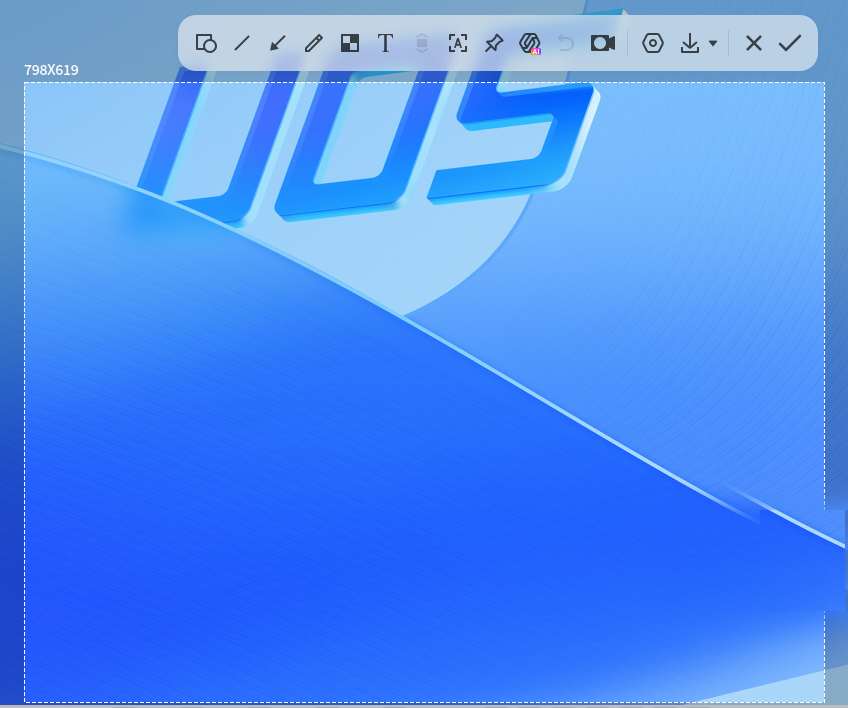
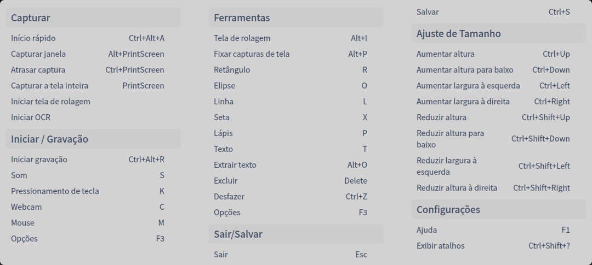
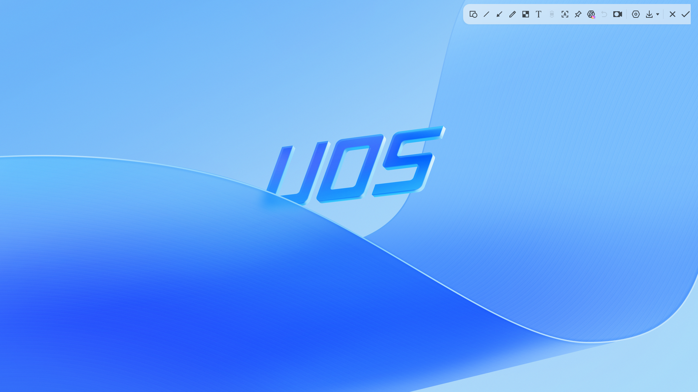
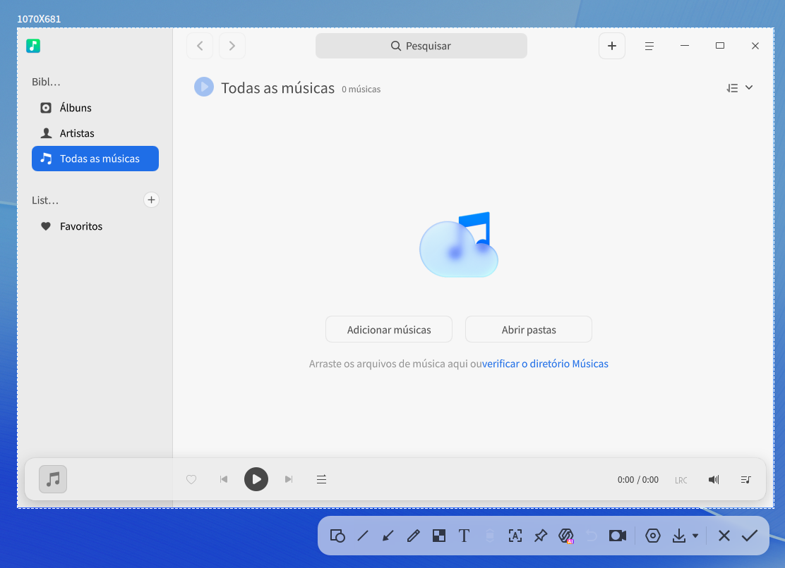
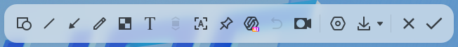
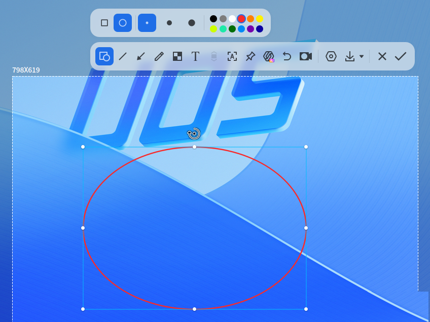
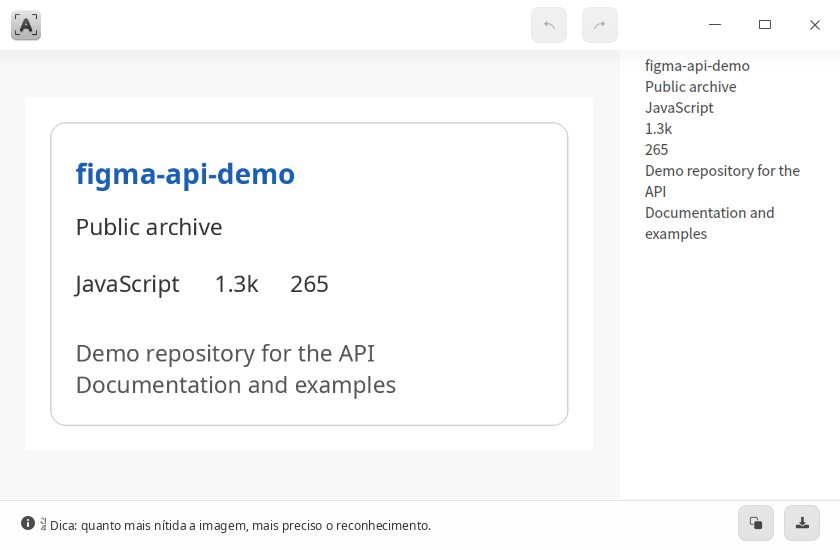
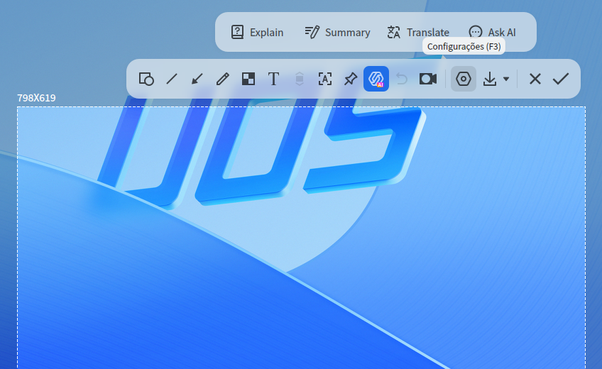
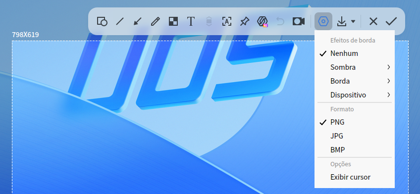
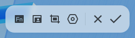

# Captura e gravação de tela|deepin-screen-recorder|

## Visão geral

A Captura e gravação de tela é uma pequena ferramenta que reúne captura e gravação de tela, com suporte a edição de imagens, fixação de imagens, captura com rolagem, reconhecimento de texto e gravação de tela.

## Primeiros passos

Você pode iniciar ou fechar a Captura e gravação de tela e também criar um atalho.

### Iniciar a Captura e gravação de tela

1. Clique no ícone do iniciador na barra de tarefas  para abrir a interface do iniciador.
2. Role a roda do mouse para cima ou para baixo ou use a busca para localizar o ícone da Captura e gravação de tela  e clique nele para iniciar.
3. Clique com o botão direito em  para:

   - Clicar em **Enviar para a área de trabalho** e criar um atalho na área de trabalho.
   - Clicar em **Enviar para a barra de tarefas** e fixar o aplicativo na barra de tarefas.
   - Clicar em **Iniciar automaticamente ao ligar** e adicionar o aplicativo aos itens de inicialização, para que ele seja executado automaticamente ao ligar o computador.

> Dica: na área de plugins do sistema na barra de tarefas, clique nos ícones   para iniciar a Captura e gravação de tela.

### Fechar a Captura e gravação de tela

- A Captura e gravação de tela é encerrada automaticamente ao final de uma captura ou de uma gravação.
- Na interface da Captura e gravação de tela, clique em  para fechar o aplicativo.
- Na interface de captura, clique com o botão direito e selecione **Salvar** ou **Sair**.

### Atalhos

Use o atalho **Ctrl + Shift + ?** para abrir a interface de visualização dos atalhos. Usar os atalhos com fluência aumenta bastante a sua produtividade.

## Selecionar e ajustar a área

### Selecionar a área de captura ou de gravação

A Captura e gravação de tela permite selecionar a tela inteira, a janela de um programa ou uma área personalizada. Ao capturar ou gravar, a área selecionada é realçada e ganha uma borda tracejada branca ao redor.

>  Observação: quando o computador tem várias telas, você também pode usar a Captura e gravação de tela para capturar áreas em telas diferentes.

#### Selecionar a tela inteira

A Captura e gravação de tela identifica automaticamente toda a tela do monitor atual.

Siga os passos abaixo para selecionar a tela inteira:

1. Use o atalho **Ctrl + Alt + A** para entrar no modo de captura, ou **Ctrl + Alt + R** para entrar no modo de gravação.
2. Mova o ponteiro do mouse para a área de trabalho; a Captura e gravação de tela seleciona automaticamente a tela inteira e mostra no canto superior esquerdo o tamanho da área de captura ou gravação atual.
3. Clique com o botão esquerdo na área de trabalho para abrir a barra de ferramentas.

Você também pode capturar a tela inteira diretamente assim:

- Se a Captura e gravação de tela estiver fixada na barra de tarefas, clique com o botão direito no ícone  da barra de tarefas e selecione **Captura de tela inteira**.
- Pressione a tecla  do teclado para capturar a tela inteira.

#### Selecionar uma janela

A Captura e gravação de tela identifica automaticamente a janela do aplicativo atual.

1. Use o atalho **Ctrl + Alt + A** para entrar no modo de captura, ou **Ctrl + Alt + R** para entrar no modo de gravação.
2. Mova o ponteiro do mouse para a janela do aplicativo aberta; a Captura e gravação de tela seleciona automaticamente essa janela e mostra no canto superior esquerdo o tamanho da área de captura ou gravação atual.
3. Clique com o botão esquerdo na janela para abrir a barra de ferramentas.

#### Selecionar uma área personalizada

Você também pode escolher livremente a área de captura ou de gravação.

1. Use o atalho **Ctrl + Alt + A** para entrar no modo de captura, ou **Ctrl + Alt + R** para entrar no modo de gravação.
2. Mantenha o botão esquerdo do mouse pressionado e arraste para selecionar a área de captura ou de gravação; no canto superior esquerdo, o tamanho da área é mostrado em tempo real.
3. Solte o botão esquerdo para concluir a seleção e abrir a barra de ferramentas.

### Ajustar a área de captura ou de gravação

Você pode fazer ajustes finos na área de captura ou de gravação, como ampliar ou reduzir a área e mover a seleção.

#### Ampliar/Reduzir a área

- Posicione o ponteiro do mouse sobre a borda branca da área de captura ou de gravação; o ponteiro muda para ,
Mantenha o botão esquerdo pressionado e arraste para ampliar ou reduzir a área.
- Pressione **Ctrl** +  ou  no teclado para ampliar a área na vertical, e **Ctrl** +  ou  para ampliá-la na horizontal.&nbsp;&nbsp;&nbsp;&nbsp;&nbsp;&nbsp;&nbsp;&nbsp;&nbsp;&nbsp;&nbsp;&nbsp;&nbsp;

#### Mover a área

Posicione o ponteiro do mouse sobre a área de captura ou de gravação; o ponteiro muda para . Você pode:
- Manter o botão esquerdo pressionado e arrastar para mover a área.
- Pressionar  ou  no teclado para mover a área na vertical, e  ou  para movê-la na horizontal.

## Captura de tela

No modo de captura, os botões da barra de ferramentas permitem desenhar formas e inserir anotações de texto na área capturada, reconhecer o texto da imagem, fixar a imagem sobre a área de trabalho e usar a **Captura com IA** para explicar, resumir ou traduzir o conteúdo capturado.

<table class="block1">
    <caption>Descrição da barra de ferramentas</caption>
    <tbody>
        <tr>
            <td style="text-align:center;"></td>
            <td>Ferramentas geométricas</td>
            <td style="text-align:center;"></td>
            <td>Linha</td>
            <td style="text-align:center;"></td>
            <td>Seta</td>
        </tr>
        <tr>
            <td style="text-align:center;"></td>
            <td>Pincel</td>
            <td style="text-align:center;"></td>
            <td>Desfoque</td>
            <td style="text-align:center;"></td>
            <td>Texto</td>
        </tr>
        <tr>
            <td style="text-align:center;"></td>
            <td>Captura com rolagem</td>
            <td style="text-align:center;"></td>
            <td>Reconhecer texto</td>
            <td style="text-align:center;"></td>
            <td>Fixar imagem</td>
        </tr>
        <tr>
            <td style="text-align:center;"></td>
            <td>Captura com IA</td>
            <td style="text-align:center;"></td>
            <td>Configurações</td>
            <td style="text-align:center;"></td>
            <td>Salvar localmente</td>            
        </tr>
        <tr>
            <td style="text-align:center;"></td>
            <td>Fechar</td>
            <td style="text-align:center;"></td>
            <td>Copiar para a área de transferência</td>            
        </tr>
    </tbody>
</table>

>  Observação: se você já tiver escolhido opções na barra de ferramentas e na barra de propriedades, como espessura da linha e tamanho da fonte, a Captura e gravação de tela salva essas configurações e as usa por padrão na próxima vez; você também pode escolher outras.

### Desenhar formas

Os botões **Ferramentas geométricas**, **Linha**, **Seta** e **Pincel** da barra de ferramentas de captura permitem desenhar formas simples, com ajuste da espessura e da cor da linha.

### Modificar formas

Se você desenhou formas na captura, pode modificá-las e movê-las.

#### Editar uma forma

1. Posicione o ponteiro do mouse sobre a linha da forma; o ponteiro muda para .
2. Clique com o botão esquerdo para entrar no modo de edição da forma, onde você pode:
   - Pressionar a tecla **Delete** do teclado para excluir a forma.
   - Posicionar o ponteiro do mouse sobre a caixa de edição, onde ele muda para , e arrastar para ampliar ou reduzir a área da forma.
   - Posicionar o ponteiro do mouse sobre  na caixa de edição, onde ele muda para , e arrastar para girar a forma.
3. Clique com o botão esquerdo fora da caixa de edição para sair do modo de edição.

#### Mover uma forma

1. Posicione o ponteiro do mouse sobre a linha da forma; o ponteiro muda para .
2. Mantenha o botão esquerdo pressionado e leve a forma para qualquer posição da área capturada.

### Ferramenta de desfoque

1. Na barra de ferramentas de captura, clique em .
2. No painel expandido da barra de ferramentas, escolha o estilo de desfoque: por padrão, o estilo mosaico, ou ainda o estilo desfoque gaussiano.
3. Escolha o modo de desenho, como seleção retangular, seleção elíptica ou pintura livre.
4. No lado direito do painel expandido, arraste para os lados para escolher a intensidade do desfoque.
5. Assim como as demais formas, o desfoque desenhado também pode ser modificado e movido.

### Adicionar anotações de texto

Complemente e explique a imagem capturada com texto, ajudando outras pessoas a entendê-la com mais clareza.&nbsp;&nbsp;

1. Na barra de ferramentas de captura, clique em .
2. No painel expandido da barra de ferramentas, escolha o tamanho da fonte e a cor; há quatro cores disponíveis.
3. Posicione o ponteiro do mouse sobre a imagem capturada; o ponteiro muda para .
4. Clique no local em que deseja inserir a anotação; uma caixa de texto para digitação é exibida.
5. Digite o texto na caixa.

### Modificar anotações de texto

Se você já adicionou anotações de texto, pode modificá-las e movê-las.

#### Mover uma anotação de texto

1. Posicione o ponteiro do mouse sobre o texto; o ponteiro muda para .
2. Mantenha o botão esquerdo pressionado e leve o texto para qualquer posição da área capturada.

#### Editar uma anotação de texto

1. Posicione o ponteiro do mouse sobre o texto; o ponteiro muda para .
2. Clique duas vezes com o botão esquerdo para entrar no modo de edição de texto, onde você pode:
   - Pressionar a tecla **Delete** do teclado para excluir a anotação de texto.
   - Alterar o texto dentro da caixa de texto.
3. Clique com o botão esquerdo fora da caixa de texto para sair do modo de edição.

### Captura com rolagem

A captura com rolagem permite capturar não só o conteúdo visível na tela, mas também o conteúdo que está além dela, atendendo à necessidade de capturar imagens longas de uma só vez.

Pré-requisito: a função de efeitos de janela em **Centro de Controle > Personalização** precisa estar ativada.

1. Depois de selecionar a área de captura, clique no botão de captura com rolagem da barra de ferramentas .
2. Mantenha o cursor do mouse dentro da área de rolagem. Você pode usar a rolagem automática ou a rolagem manual e até alternar entre as duas:

   - **Rolagem automática**: clique com o botão esquerdo dentro da área de captura; a área em que o cursor está rola automaticamente para cima e as imagens capturadas são unidas em uma única imagem longa. Durante a rolagem automática, clique com o botão esquerdo dentro da área de captura, ou mova o cursor para fora dela, para pausar a captura; clique novamente na área para continuar.
   - **Rolagem manual**: com o cursor do mouse dentro da área de captura, role a roda do mouse para cima ou para baixo para capturar as imagens. Pare de rolar a roda para pausar a captura; role novamente para continuar.

3. Clique no botão de captura da barra de ferramentas  para salvar a imagem longa.

Cuidados:
- A área de captura não deve ultrapassar o intervalo de rolagem; evite selecionar a janela inteira ou a tela inteira.
- A área de captura não deve ser muito pequena; recomenda-se altura maior ou igual a 50 px.
- Evite que a área de captura contenha várias regiões com rolagem.
- Evite que a área de captura com rolagem contenha muito conteúdo repetido, como áreas em branco, cores iguais e trechos longos de texto idêntico.
- Evite que a área de captura com rolagem contenha imagens animadas, vídeos, marcas d'água e fundos de cor sólida.
- Durante a rolagem, mantenha o deslocamento na vertical e evite arrastar a barra de rolagem.
- Durante a rolagem, evite trocar de janela.
- Não faça a rolagem rápido demais.

### Reconhecer texto

Para conteúdos da área capturada que não podem ser copiados, use a função de reconhecimento de texto para extrair o texto.

1. Depois de selecionar a área de captura, clique no botão de reconhecimento de texto da barra de ferramentas ; a janela de reconhecimento é exibida e o texto da imagem é identificado.
2. Você pode editar o texto reconhecido, copiá-lo ou salvá-lo como TXT, entre outras operações.

### Fixar imagem

A função de fixar imagem transforma a captura em uma janela flutuante na área de trabalho, o que facilita consultar, comparar e organizar informações rapidamente.

Depois de selecionar a área a capturar, clique no botão de fixar imagem da barra de ferramentas ; a captura passa a flutuar sobre a área de trabalho. Com a imagem fixada, você pode:

- Mover a imagem com o mouse.
- Posicionar o ponteiro do mouse sobre a imagem e rolar a roda para cima ou para baixo para redimensioná-la proporcionalmente.
- Clicar no botão  para salvar a imagem.

### Captura com IA

Na barra de ferramentas de captura, clique no botão para abrir o menu de IA, onde você pode:

- Selecionar **Explicar** e pedir ao **AI Copilot** que explique o texto da captura;
- Selecionar **Resumir** e pedir ao **AI Copilot** que resuma o texto da captura;
- Selecionar **Traduzir** e pedir ao **AI Copilot** que traduza o texto da captura;
- Selecionar **Perguntar à IA** para abrir o **UOS AI** e enviar a captura à caixa de diálogo, permitindo uma conversa mais aprofundada.

### Captura com atraso

A captura com atraso permite registrar o conteúdo da tela em um estado ou momento específico.

- Use o atalho **Ctrl** +  para iniciar a captura com atraso.
- No terminal, execute o comando "deepin-screen-recorder -d n", em que n é o tempo de atraso em segundos.

### Configurações

Na barra de ferramentas de captura, você também pode clicar no botão para abrir o menu de configurações:

- Selecione **Sem borda/Sombra/Borda externa/Moldura** para definir o efeito de borda da imagem.
- Selecione **PNG/JPG/BMP** para definir o formato da imagem.
- Selecione **Mostrar cursor** para que a posição e o estilo do cursor dentro da área de captura também apareçam na imagem gerada.

### Salvar a captura

Clique no botão da barra de ferramentas ou clique com o botão direito e selecione **Salvar** para gravar a captura localmente. Clique no pequeno ícone à direita desse botão para abrir as opções e definir a regra de salvamento.

- Selecione **Perguntar sempre** para escolher o caminho de salvamento a cada clique no botão de salvar.
- Selecione **Local especificado** > **Área de trabalho** para salvar a imagem na área de trabalho.
- Selecione **Local especificado** > **Imagens** para salvar a captura automaticamente na pasta de imagens.
- Selecione **Local especificado** > **Escolher local ao salvar** para escolher o caminho de salvamento no clique atual; nas próximas capturas, a imagem é salva nesse caminho por padrão, a menos que outra opção seja definida.

### Copiar para a área de transferência

Clique no botão da barra de ferramentas , clique duas vezes com o botão esquerdo ou use o atalho **Ctrl + S** para copiar a imagem para a área de transferência.

## Gravação de tela

No modo de gravação, os botões da barra de ferramentas de gravação permitem gravar som, imagem da câmera, exibição das teclas pressionadas e cliques do mouse.

>  Observação: tecnologias de decodificação diferentes oferecem conjuntos de recursos diferentes; consulte a interface do aplicativo.

<table class="block1">
    <caption>Descrição da barra de ferramentas</caption>
    <tbody>
        <tr>
            <td style="text-align:center;"></td>
            <td>Mostrar teclas</td>
            <td style="text-align:center;"></td>
            <td>Ativar câmera</td>
            <td style="text-align:center;"></td>
            <td>Alternar captura</td>
        </tr>
          <tr>
            <td style="text-align:center;"></td>
            <td>Configurações</td>
            <td style="text-align:center;"></td>
            <td>Fechar</td>
            <td style="text-align:center;"></td>
            <td>Iniciar gravação</td>
        </tr>
    </tbody>
</table>

### Configurações de gravação

Na barra de ferramentas de gravação, você pode:

- Mostrar teclas: clique no botão para exibir as teclas do teclado pressionadas durante a gravação, com no máximo cinco teclas ao mesmo tempo.

- Ativar câmera: clique no botão para iniciar a câmera e gravar simultaneamente a imagem da câmera e a da tela; arraste a janela da câmera para ajustar a posição.

   >  Atenção: verifique antes se o dispositivo conectado oferece suporte a gravação de som ou à câmera; caso contrário, a operação correspondente não estará disponível.

- Mais configurações: clique no botão e, no menu de configurações, escolha o formato de vídeo **GIF**, **MP4** ou **MKV** e defina a taxa de quadros, a gravação de som, a exibição do cursor e outros itens.

   >  Observação: a arquitetura MIPS não é compatível com o formato GIF.

### Gravar a tela

Siga os passos abaixo para registrar a atividade da tela.

1. Use o atalho **Ctrl + Alt + R** para iniciar a gravação de tela.
2. Selecione a área de gravação.
3. Na barra de ferramentas de gravação, ajuste as opções de gravação.
4. Clique no botão de gravação ; após uma contagem regressiva de 3 segundos, a gravação começa, e o ícone de gravação aparece na área da bandeja piscando.
5. Você pode encerrar a gravação de uma das seguintes formas:
   - Usando o atalho **Ctrl + Alt + R**.
   - Clicando no ícone da Captura e gravação de tela na barra de tarefas.
   - Clicando no ícone de gravação na área da bandeja.

Ao final da gravação, o vídeo é salvo automaticamente na área de trabalho.

>  Observação:
> - Quando a barra de tarefas está na parte superior ou inferior da área de trabalho, o ícone de gravação na área da bandeja mostra a duração da gravação.
> - Ao gravar vídeo com vários monitores conectados, seja no modo de duplicação ou no modo de extensão, a gravação abrange apenas a tela em uso no momento.

## Consultar o manual de ajuda

Depois de iniciar a Captura e gravação de tela, pressione a tecla **F1** do teclado para abrir o manual de ajuda.
