# 截圖錄影|deepin-screen-recorder|

## 概述

截圖錄影是一款集截圖、螢幕錄影於一體的小工具，支援圖片編輯、序號標註、圓角截圖、固定尺寸、貼圖、捲動截圖、文字辨識、表格辨識、AI截圖、螢幕錄影等功能。

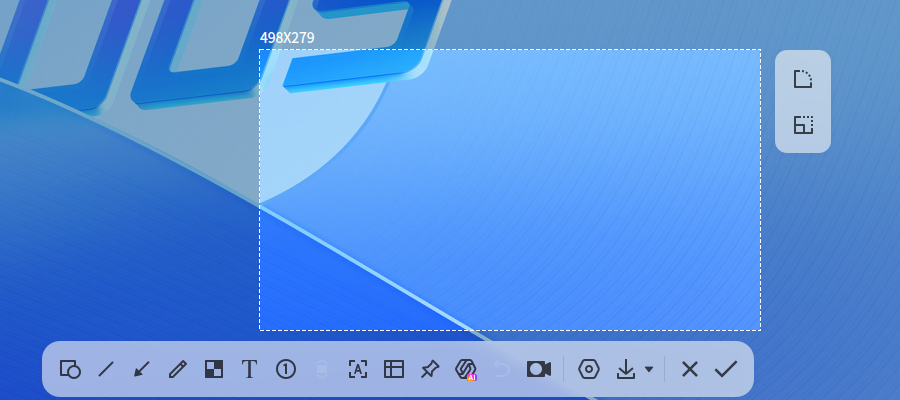

## 使用入門

了解如何啟動、關閉截圖錄影，同時建立捷徑。

### 啟動截圖錄影

1. 點選工作列上的啟動器圖示 ，進入啟動器介面。
2. 滾動滑鼠滾輪或搜尋找到截圖錄影圖示 ，點選啟動。
3. 右鍵點選 ，您可以：
   - 點選 **傳送到桌面**，在桌面建立捷徑。
   - 點選 **傳送到工作列**，將應用程式釘選到工作列。
   - 點選 **開機自動啟動**，將應用程式加入開機啟動項目，電腦開機時自動執行。

> 秘訣：在工作列系統匣區域，點選圖示  也可啟動應用程式。

### 關閉截圖錄影

- 截圖或錄影結束後自動關閉。
- 在應用程式介面點選  關閉。
- 截圖模式下右鍵點選，選擇 **撤銷**、**儲存** 或 **離開**。

### 快速鍵

使用 **Ctrl + Shift + ?** 開啟快速鍵預覽介面。熟練使用可提升操作效率。

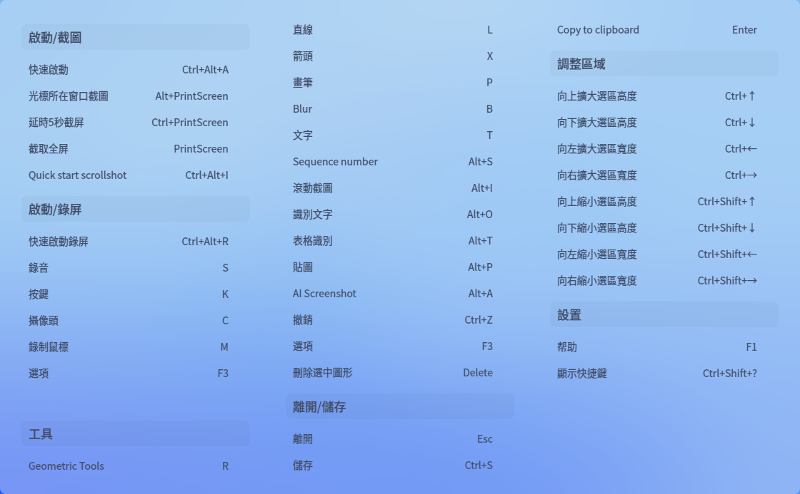

## 選取與調整區域

### 選取截圖錄影區域

支援全螢幕、應用程式視窗及自訂區域選取。選取區域會高亮顯示並有白色虛線邊框。

>  說明：多螢幕環境下可擷取不同螢幕區域。

#### 全螢幕模式
自動偵測目前顯示器全螢幕。

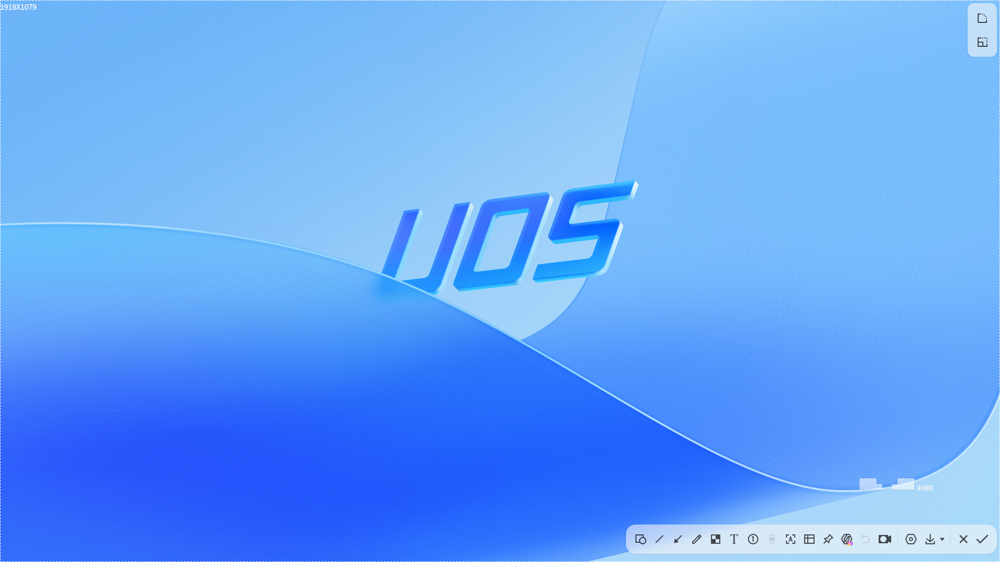

選取步驟：
1. 使用快速鍵 **Ctrl + Alt + A** (截圖) 或 **Ctrl + Alt + R** (錄影)。
2. 移動滑鼠至桌面自動選取全螢幕，左上角顯示尺寸。
3. 左鍵點選桌面顯示工具列。

直接擷取方式：
- 工作列釘選時：右鍵點選圖示  選 **全螢幕截圖**。
- 按下鍵盤  鍵。

#### 視窗模式
自動偵測開啟的應用視窗。

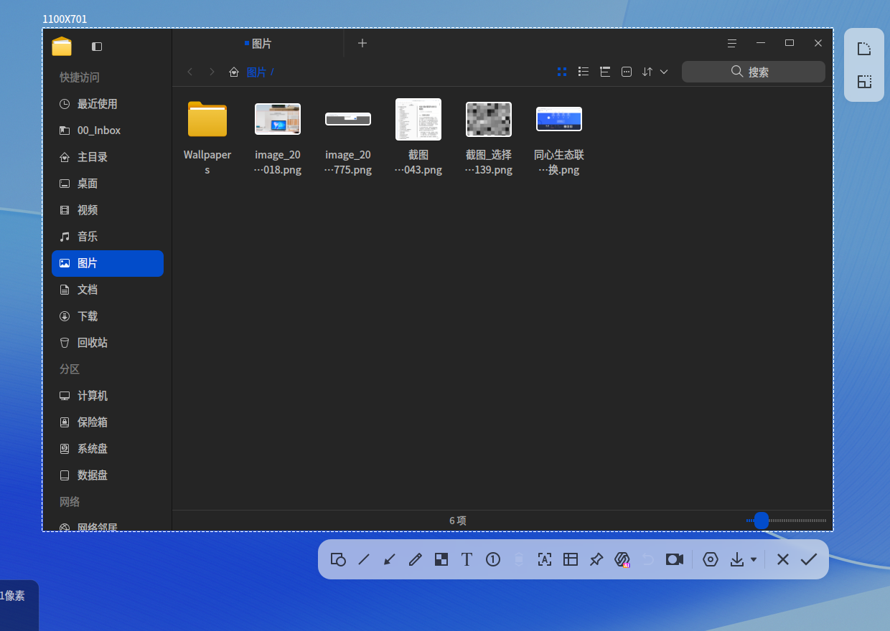

1. 使用快速鍵 **Ctrl + Alt + A** 或 **Ctrl + Alt + R**。
2. 滑鼠懸停視窗自動選取。
3. 左鍵點選視窗顯示工具列。

#### 自訂區域
自由選取任意範圍。

1. 使用快速鍵 **Ctrl + Alt + A** 或 **Ctrl + Alt + R**。
2. 按住左鍵拖曳選取區域，左上角即時顯示尺寸。
3. 放開左鍵確認區域，顯示工具列。

### 調整截圖錄影區域
可微調區域大小或位置。

#### 調整大小
- 拖曳白色邊框 (游標變 )。
- 按 **Ctrl** + / 垂直調整，**Ctrl** + / 水平調整。&nbsp;&nbsp;&nbsp;&nbsp;&nbsp;&nbsp;&nbsp;&nbsp;&nbsp;&nbsp;&nbsp;&nbsp;&nbsp;
- 按 **Ctrl + Shift** + 、、 或 ，可逐像素縮小區域的高度或寬度。

#### 移動位置
- 游標為  時拖曳區域。
- 使用方向鍵 (/ 等) 微調。

### 圓角截圖

選中截圖錄影區域後，區域右側會出現兩個快捷按鈕，上方的是圓角按鈕（提示為「圓角」）。

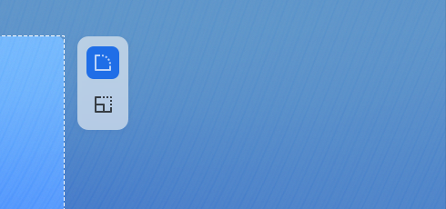

1. 點選區域右側的圓角按鈕，展開圓角面板。
2. 拖曳滑桿，或直接在數值框中輸入數值，設定圓角半徑，最大可設定為 60。
3. 設定完成後，區域邊框會按該半徑顯示為圓角；儲存或複製的圖片，四角同樣被裁為圓角，圓角以外的部分為透明。

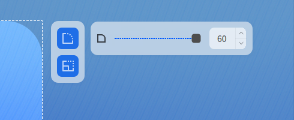

### 固定尺寸/比例

選中截圖錄影區域後，區域右側下方的按鈕用於將選區固定為指定的尺寸或寬高比（提示為「尺寸/比例」）。

1. 點選區域右側的尺寸/比例按鈕，展開面板。
2. 點選面板左側的下拉式選單，選擇 **尺寸** 或 **比例**。
   - 選擇 **尺寸**，在數值框中輸入固定的寬度和高度，單位為像素。
   - 選擇 **比例**，在數值框中輸入寬高比的兩個數值，例如 166 和 93。
3. 點選面板右側的保持按鈕，可在下次截圖時沿用該尺寸或比例，該按鈕的提示為「選中後，下次截圖保持該尺寸/比例」。

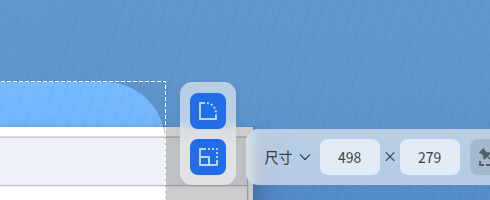

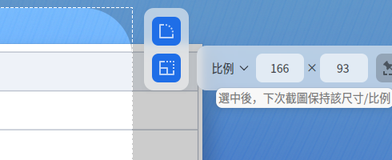

## 截圖功能
截圖模式下使用工具列進行圖形繪製、文字註解、序號標註等操作，同時可辨識圖中文字、辨識表格、將圖片置頂貼於桌面、使用**AI截圖**對截圖內容進行解釋、總結、翻譯等處理。

<table class="block1">
    <caption>工具列說明</caption>
    <tbody>

        <tr>
            <td style="text-align:center;"></td>
            <td>幾何工具</td>
            <td style="text-align:center;"></td>
            <td>直線</td>
            <td style="text-align:center;"></td>
            <td>箭頭</td>
        </tr>
        <tr>
            <td style="text-align:center;"></td>
            <td>畫筆</td>
            <td style="text-align:center;"></td>
            <td>模糊</td>
            <td style="text-align:center;"></td>
            <td>文字</td>
        </tr>
        <tr>
            <td style="text-align:center;"></td>
            <td>序號標註</td>
            <td style="text-align:center;"></td>
            <td>捲動截圖</td>
            <td style="text-align:center;"></td>
            <td>辨識文字</td>
        </tr>
        <tr>
            <td style="text-align:center;"></td>
            <td>表格辨識</td>
            <td style="text-align:center;"></td>
            <td>貼圖</td>
            <td style="text-align:center;"></td>
            <td>AI截圖</td>
        </tr>
        <tr>
            <td style="text-align:center;"></td>
            <td>撤銷</td>
            <td style="text-align:center;"></td>
            <td>錄影</td>
            <td style="text-align:center;"></td>
            <td>設定</td>
        </tr>
        <tr>
            <td style="text-align:center;"></td>
            <td>保存到本地</td>
            <td style="text-align:center;"></td>
            <td>關閉</td>
            <td style="text-align:center;"></td>
            <td>複製到剪貼板</td>
        </tr>
    </tbody>
</table>

>  說明：若已設定線條粗細、字型大小等，應用程式會保存設定，下次啟動時自動套用，您也可重新設定。

### 繪製圖形
通過截圖工具列上的**幾何工具**、**直線**、**箭頭**、**畫筆**按鈕，可繪製簡易圖形，並支援設定線條的粗細與顏色。點選**幾何工具**後，可在展開的面板中選擇矩形或橢圓，再於截圖區域中拖曳滑鼠完成繪製。

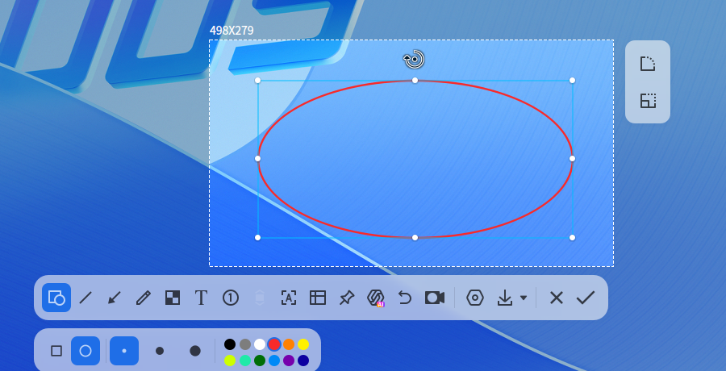

### 修改圖形
編輯或移動已繪製圖形。

#### 編輯圖形
1. 游標移至圖形邊線變 。
2. 點選進入編輯模式：
   - 按 **Delete** 刪除
   - 游標變  時拖曳調整大小
   - 拖曳  手柄 (游標變 ) 旋轉
3. 編輯框外點選結束編輯。

#### 移動圖形

1. 游標移至圖形邊線變 。
2. 按住左鍵拖曳移動。

### 撤銷操作

點選工具列上的撤銷按鈕 ，或按下快速鍵 **Ctrl + Z**，可撤銷上一步的繪製或標註操作。目前沒有可撤銷的操作時，該按鈕會變灰。

### 模糊工具

1. 點選 。
2. 選擇樣式： 或 。
3. 選擇模式： (矩形選取)、 (橢圓選取)、 (自由繪製)。
4. 拖曳滑桿調整強度。
5. 與其他圖形一致，已繪製的模糊圖形同樣支援修改與移動。

### 新增文字註解

為截圖新增說明文字。&nbsp;&nbsp;&nbsp;&nbsp;&nbsp;&nbsp;&nbsp;&nbsp;&nbsp;&nbsp;&nbsp;&nbsp;&nbsp;

1. 點選 。
2. 選擇字型大小/顏色（4色可選）。
3. 游標變 。
4. 點選要註解位置，出現文字框。
5. 輸入文字。

### 修改文字註解
編輯或移動現有文字註解。

#### 移動文字
1. 游標移至文字變 。
2. 按住左鍵拖曳移動。

#### 編輯文字
1. 游標移至文字變 。
2. 雙擊進入編輯模式：
   - 按 **Delete** 刪除
   - 直接修改文字內容
3. 文字框外點選結束編輯。

### 序號標註

使用序號標註，可以在截圖中依序標出要點，便於講解和說明。

1. 在截圖工具列中，點選 ，或按下快速鍵 **Alt + S**。
2. 在展開的面板中選擇標記的大小和顏色。
3. 在截圖區域中點選，截圖錄影會依序新增帶圓圈的序號標記，依次為 ①、②、③ 等。

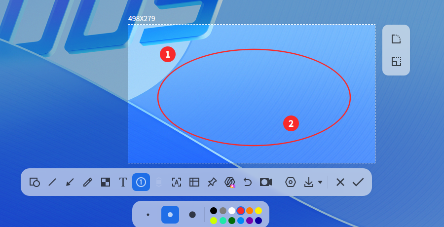

### 捲動截圖
擷取超出螢幕的長內容（如網頁）。

**前提**：啟用 **控制中心 > 個人化 > 視窗特效**。

1. 選取區域後點選 。
2. 保持游標在捲動區域內，可混合使用：
   - **自動捲動**：左鍵點選開始/暫停自動捲動
   - **手動捲動**：使用滑鼠滾輪控制
3. 點選  儲存長圖。

**注意事項**：
- 避免選取整個視窗/全螢幕
- 區域高度建議 ≥50px
- 避免區域內含多個捲動元件
- 減少重複內容（空白/純色/相同文字）
- 避免包含 GIF/影片/浮水印
- 垂直捲動，勿拖動捲軸
- 截圖期間勿切換視窗
- 捲動速度適中

### 辨識文字
擷取圖片中的文字。

1. 選取區域後點選 ，或按下快速鍵 **Alt + O**，彈出辨識視窗。
2. 可編輯、複製或另存為 TXT。

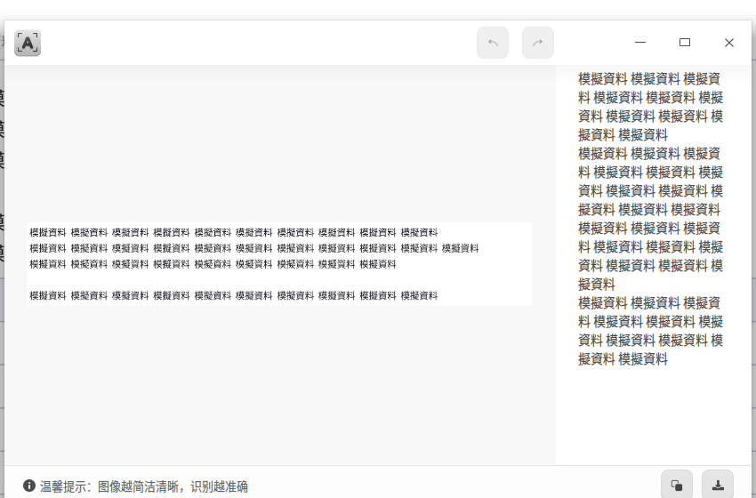

### 表格辨識

對於截圖區域中的表格，可以使用表格辨識功能，將表格內容擷取為可貼上的格式。

1. 選取區域後點選 ，或按下快速鍵 **Alt + T**。截圖錄影會同時將截圖複製到剪貼板。
2. 介面顯示 **表格辨識中…**，辨識完成後彈出 **表格辨識** 對話方塊，並顯示 **表格已辨識成功！**。

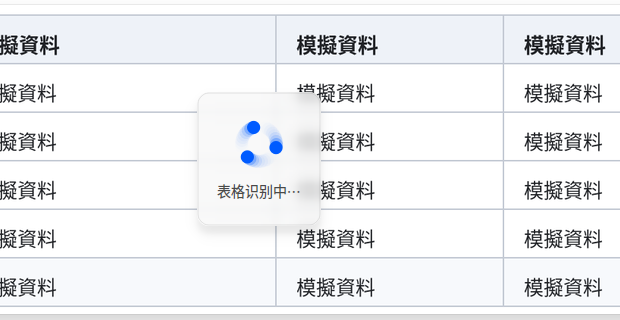

3. 點選 **複製為Excel格式**，辨識結果會以表格形式複製到剪貼板，您可以直接貼上到表格軟體中；點選 **取消**，關閉對話方塊，不複製辨識結果。

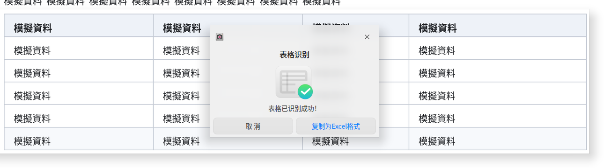

### 貼圖

將截圖固定為桌面浮動視窗，方便對照參考。

選取區域後點選 ，或按下快速鍵 **Alt + P**，圖片將浮於桌面：

- 拖曳移動位置
- 滾動滑鼠滾輪縮放
- 點選  儲存

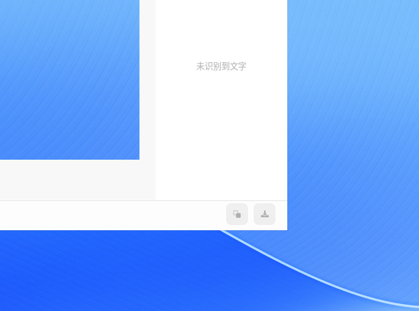

### AI截圖

選取區域後點選，或按下快速鍵 **Alt + A**，展開 AI菜單：

- **解釋**：調起**AI 隨航**解釋截圖中的文字
- **總結**：調起**AI 隨航**總結截圖中的文字
- **翻譯**：調起**AI 隨航**翻譯截圖中的文字
- **問問 AI**：調起**小U助手**並將擷圖傳送至對話方塊，以進行更深入的對話。

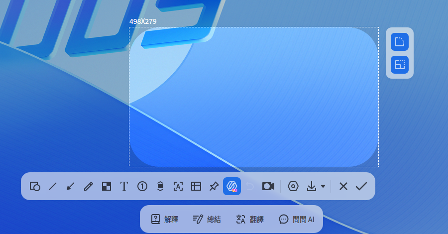

### 延遲截圖

延遲指定時間後擷取畫面。

- 快速鍵：**Ctrl** + 
- 終端指令：`deepin-screen-recorder -d n`（`n` 為延遲秒數）

### 設定

選取區域後點選，或按下快速鍵 **F3**，展開設定菜單：

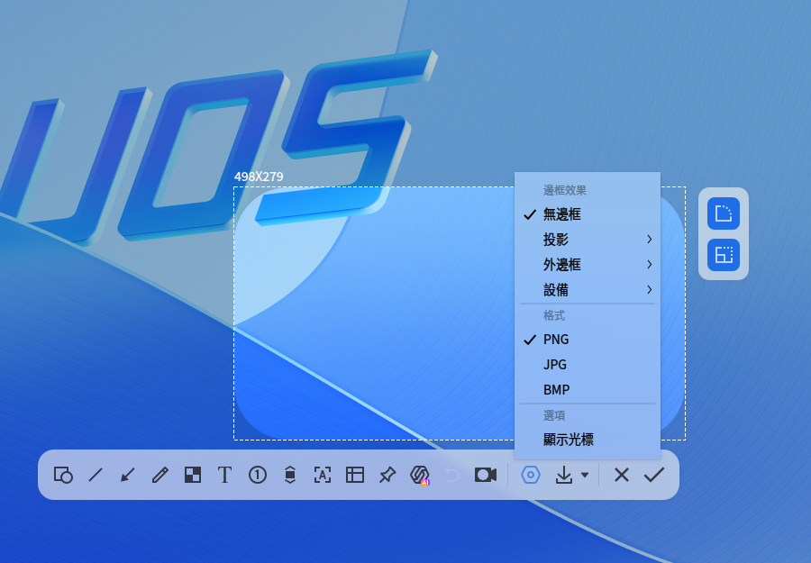

- **邊框效果**：無邊框/投影/外邊框/設備
- **格式**：PNG/JPG/BMP
- **顯示光標**：截圖包含游標

### 儲存截圖

選取區域後點選或單擊滑鼠右鍵選擇 **儲存**，或按下快速鍵 **Ctrl + S**，可將截圖儲存至本機，單擊該按鈕右側的小圖示展開選項，即可設定儲存規則。

- **每次詢問**：每次點選儲存按鈕後選擇儲存路徑
- **指定位置** > **桌面**：儲存至桌面
- **指定位置** > **圖片**：儲存至圖片資料夾
- **指定位置** > **保存時選擇位置**：本次點選儲存按鈕後選擇儲存路徑，下次截圖儲存時將預設儲存至該路徑，除非另行設定。

### 複製到剪貼板

選取區域後點選，或雙擊滑鼠左鍵，或使用快速鍵 **Enter**，將截圖複製到剪貼板中。

## 螢幕錄影

錄製螢幕活動，支援音訊、鏡頭、按鍵顯示等。

>  功能依硬體/編碼支援而定。

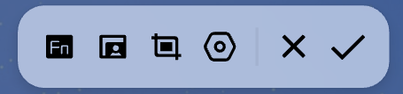

<table class="block1">
    <caption>工具列說明</caption>
    <tbody>
        <tr>
            <td style="text-align:center;"></td>
            <td>顯示按鍵</td>
            <td style="text-align:center;"></td>
            <td>開啟鏡頭</td>
            <td style="text-align:center;"></td>
            <td>截圖</td>
        </tr>
          <tr>
            <td style="text-align:center;"></td>
            <td>設定</td>
              <td style="text-align:center;"></td>
            <td>關閉</td>
              <td style="text-align:center;"></td>
            <td>確認</td>
        </tr>
    </tbody>
</table>

### 錄影設定

在錄影工具列中，您可以：

- **顯示按鍵**：點選 ，或按下快速鍵 **K**，錄影時顯示鍵盤按鍵操作，最多同時顯示5個按鍵操作。

- **開啟鏡頭**：點選 ，或按下快速鍵 **C**，同時錄製螢幕與鏡頭畫面（可拖曳調整位置）。
  
  >  請確認裝置支援音訊/鏡頭錄製

- **截圖**：點選 ，在錄影過程中擷取目前畫面。

- **更多設定**：點選 ，或按下快速鍵 **F3**，在設定菜單中可進行以下設定：

  - **格式**：選擇 **GIF**、**MP4** 或 **MKV** 影片格式。
  - **影格數**：選擇 **5 fps**、**10 fps**、**20 fps**、**24 fps** 或 **30 fps**。
  - **聲音**：選擇 **麥克風** 或 **系統音訊**，兩者可以同時勾選。
  - **選項**：選擇 **顯示光標** 或 **顯示滑鼠點擊**。
  - **儲存方式**：選擇 **桌面** 或 **影片**，設定錄影檔案的儲存位置。

  >  MIPS架構不支援GIF

### 開始錄影
1. 按 **Ctrl + Alt + R**
2. 選取錄影區域
3. 設定選項
4. 點選 ，或按下快速鍵 **Enter**，3秒倒數後開始錄影，系統匣圖示  閃爍
5. 結束錄影方式：
   - **Ctrl + Alt + R**
   - 點選工作列圖示
   - 點選系統匣圖示

錄影結束後，錄影檔案會自動儲存至 **影片** 資料夾下的 **Screen Recordings** 目錄，檔名為「錄屏_<區域>_<時間戳>」。若在上一步的 **儲存方式** 中選擇 **桌面**，錄影檔案則儲存至桌面。

>  
> - 工作列位於頂部/底部時，系統匣圖示顯示錄影時間
> - 多螢幕環境下僅錄製目前操作螢幕

## 檢視說明手冊
使用時按下 **F1** 開啟說明手冊。
